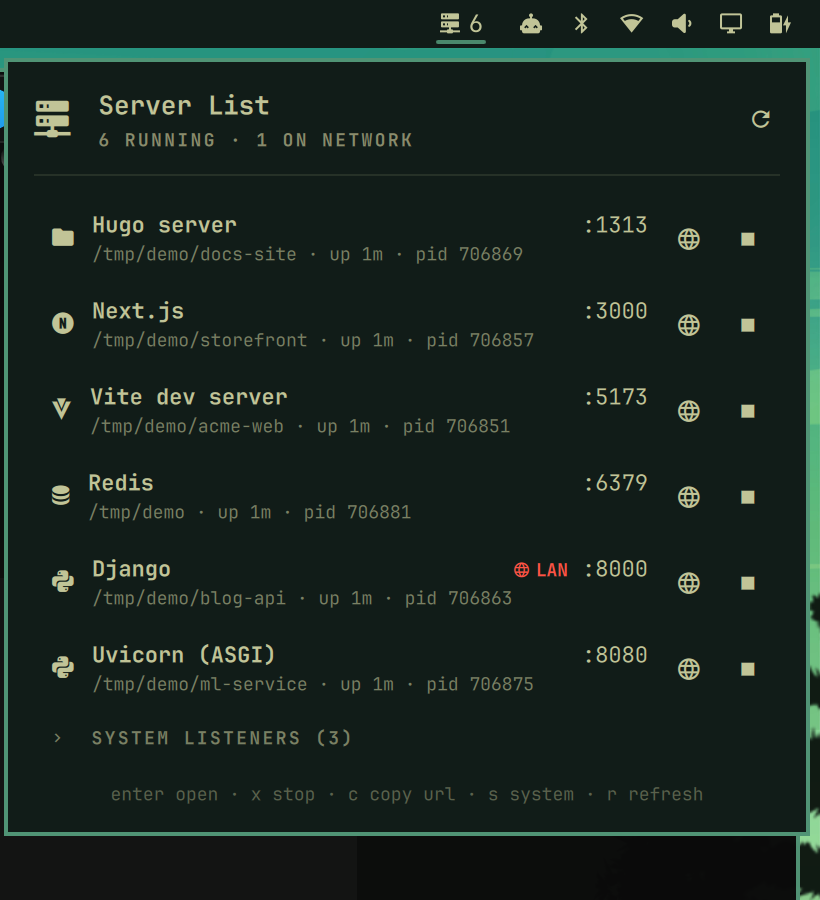

# omarchy-server-list-plugin

An [Omarchy](https://omarchy.org) shell plugin that adds a bar widget showing every local server running on your machine, says what each one is, and lets you open or stop it from a dropdown.

- **Status:** done (archived 2026-10-06)
- **Stack:** Python 3 standard library (`bin/servers.py`), QML (Omarchy shell / Quickshell)
- **Run it:** `omarchy plugin add https://github.com/Kb4Zod/omarchy-server-list-plugin.git --enable`
- **Repo:** github.com/Kb4Zod/omarchy-server-list-plugin (public)



## Features

- The bar icon `󰒍 N` shows how many of your servers are running. It dims when none are.
- The dropdown lists each server with:
  - a friendly name: Vite, Next.js, Django, Hugo, Ollama, Postgres, and so on. Generic
    runtimes show their script, like `Python · todo-api/server.py`.
  - its port(s), working directory, uptime and pid.
  - a red **LAN** badge when the server listens on all interfaces rather than localhost only.
  - the full command line when the row is highlighted.
- **Open** (󰖟) opens `http://localhost:<port>` in your browser.
- **Stop** (󰓛) takes two presses: the first arms it (󰄬), and a second press within
  4 seconds sends `SIGTERM`. If the process hasn't exited after 3 seconds, it gets
  `SIGKILL`. This means a stray click can't take down something important.
  - Supervisors such as `npm run dev`, `uvicorn --reload` and nodemon are stopped
    together with the server, so it doesn't just respawn. Your shell is never touched.
  - Signals go through pidfds, after checking the process start time, so a pid that
    was recycled since the list refreshed is never hit.
- **System listeners** are collapsed at the bottom. These are sockets owned by
  root or other users, like CUPS and DNS. They're listed for information only
  and can't be stopped from here.
- Docker containers with published ports are shown and stopped with `docker stop`
  when your user can reach the Docker socket.

## Keyboard

With the dropdown open:

| Key | Action |
|---|---|
| `j` / `k` / arrows | move |
| `enter` | open in browser (or expand system listeners) |
| `x` `x` | stop the highlighted server |
| `c` | copy its URL |
| `s` | show / hide system listeners |
| `r` | refresh |
| `esc` | close |

In the bar, left-click toggles the dropdown and right-click refreshes.

## Install

```bash
omarchy plugin add https://github.com/Kb4Zod/omarchy-server-list-plugin.git --enable
```

The widget lands in the right section of the bar. To move it, run:

```bash
omarchy bar move kb4zod.server-list --section right
```

To remove it: `omarchy plugin remove kb4zod.server-list`.

**Requirements:** `python3`, which Omarchy ships. Optional: `wl-copy` for copying
URLs, and `docker` for container support.

## Settings

Settings go inline on the widget's entry in `~/.config/omarchy/shell.json`:

```json
{ "id": "kb4zod.server-list", "refreshIntervalSec": 10, "showCount": true,
  "hideWhenEmpty": false, "showSystem": false, "ignore": ["codex"] }
```

| Key | Default | Meaning |
|---|---|---|
| `refreshIntervalSec` | `10` | Background poll interval for the bar count. While open, it polls every 3 s. |
| `showCount` | `true` | Show the number next to the icon. |
| `hideWhenEmpty` | `false` | Hide the widget entirely when nothing is running. |
| `showSystem` | `false` | Start with system listeners expanded. |
| `ignore` | `[]` | Process names or labels to leave out (case-insensitive), e.g. `["codex", "Ollama"]`. |

## IPC

```bash
omarchy-shell kb4zod.server-list toggle   # also: open, close, refresh
omarchy-shell kb4zod.server-list count    # number of servers, as text
omarchy-shell kb4zod.server-list state    # panel state as JSON (handy for scripted tests)
```

Bind it to a key in `~/.config/hypr/bindings.lua` if you like.

## How it works

`bin/servers.py` is a dependency-free Python script and does all the work:

- `servers.py list` reads `/proc/net/tcp` and `/proc/net/tcp6` to find listening
  sockets. It maps socket inodes to your own processes via `/proc/<pid>/fd`, then
  emits JSON. No root, `ss` or `lsof` is needed.
- `servers.py stop <pid> [start-ticks]` stops the server and its supervising parents in the
  same process group. It sends SIGTERM, waits, then sends SIGKILL, and refuses pid 1 and itself.
- `servers.py stop-container <id>` runs `docker stop`.

`Panel.qml` is the bar button and dropdown. It's built from Omarchy's own
`qs.Ui` components, so it follows your theme.

## Development

```bash
python3 -m unittest -v tests/test_servers.py     # unit + live tests (spawns throwaway servers)
omarchy plugin validate .
rsync -a --delete --exclude .git --exclude tests ./ ~/.config/omarchy/plugins/kb4zod.server-list/
```

Saving into `~/.config/omarchy/plugins/` hot-reloads the widget, but the
`kb4zod.server-list` IPC target can stay bound to the old instance. To check, run
`quickshell ipc -p /usr/share/omarchy/shell show`. If the target is stale, run
`omarchy restart shell` before testing over IPC.

To read the shell log, run `quickshell log /run/user/$UID/quickshell/by-id/*/log.qslog`.

## License

MIT
